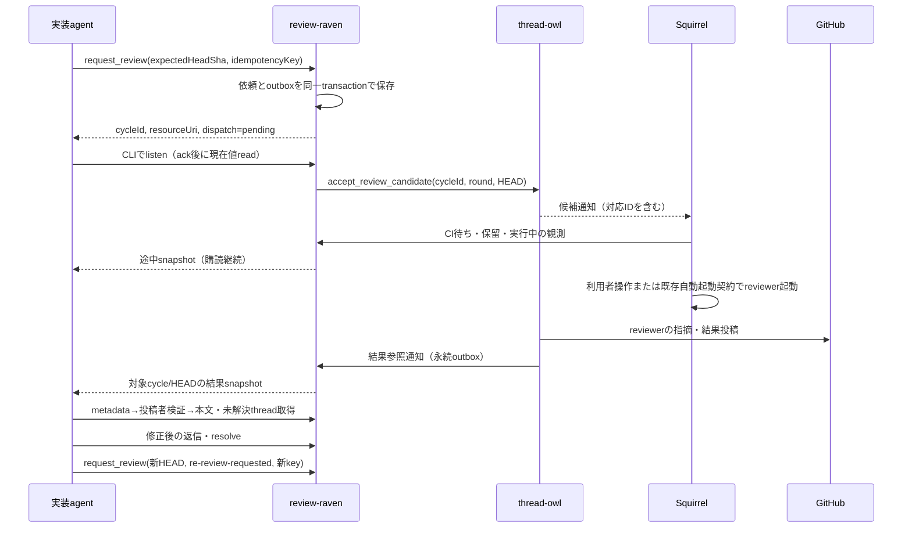

# レビュー依頼・実施・実行観測の責務設計（#144）

状態: 設計案。2026-10-21 のローカルコード調査に基づく。新API・永続化・配備は未実装。
対象: [review-raven#144](https://github.com/scottlz0310/review-raven/issues/144)、[squirrel-notifier#497](https://github.com/scottlz0310/squirrel-notifier/issues/497)。

## 決定

review-raven を初回依頼・再依頼・進捗購読・指摘対応の公開窓口とする。thread-owl は候補検証、reviewer 内部 queue、レビュー結果の生成と公開根拠を所有する。Squirrel は起動・CI待ち・保留・プロセス終了の観測を所有する。

queue 全体は移設しない。review-raven は依頼の同一性、受付と配送、観測の対応付け、購読者の権限を担うため、thread-owl の単なる proxy にはしない。レビュー結果は GitHub 上の thread-owl 投稿を正本とし、review-raven には結果参照と再構築可能な射影だけを保存する。

既存API・resource・skill は段階移行まで維持する。CIとレビューの並行化（D3）、CLI廃止を含む購読内製化全体（D4）、reviewer並列化（D8）は再開しない。新しいサーバー間イベント連携はこの責務分離に必要な範囲に限る。

## 調査の再現性と限界

以下のコミットの作業ツリーを読み取った。配備中バージョン・資格情報・実機動作を検証した記録ではない。Squirrel の `docs/review-cycle-automation.md` には既存の未コミット変更があり、本設計の根拠には使わず変更もしない。

| repo | 調査HEAD | 主な根拠（パスは各repo相対） |
|---|---|---|
| review-raven | `5672f6afe66f0d21c44f3333aecae0bf580c429f` | `internal/tools/server.go`、`threads.go`、`checks.go`、`internal/store/db.go`、`internal/middleware/auth.go` |
| thread-owl | `f48d303e839c9150d6cc8a5f7b56ef5344f2205b` | `src/mcp/server.ts`、`src/mcp/tools/`、`src/queue/review-queue.ts`、`review-status.ts`、`src/webhook/handlers/` |
| squirrel-notifier | `d21e6b7937c04a26c285959e39bf37d6e442d02d` | `winui3/SquirrelNotifier.WinUI3/Models/ReviewStatusModels.cs`、`Services/ReviewStatusService.cs`、`ReviewCycleCoordinator.cs`、`McpSubscriptionService.cs`、`Helpers/ReviewStatusDocumentBuilder.cs` |
| Mcp-Docker | `39c5ccc9942609bb8fd48277c46720c44ab68a3b` | `docker-compose.yml`、`config/mcp-profiles.yml`、`internal/register/`、両roleの `skills/*/SKILL.md` と `references/` |
| mcp-gateway | `3476d93bcdef2cdd2e15b413d908dc9d5ddd78c4` | `internal/router/router.go`、`internal/proxy/handler.go` |
| mcp-resource-subscriber | `fd6bbce12caed73138e18192e2ec293f2e43b2d9` | `src/client/subscriptionClient.ts`、`jsonOutput.ts`、`cli.ts`、`README.md` |

## 現行の公開面・状態・利用者の棚卸し

| 現行機能・状態 | 所有者／利用者 | 分類・越境と対応 |
|---|---|---|
| `enqueue_review(owner, repo, prNumber, reason, requestedBy?)` | owl／実装agent、reviewed skill、CLI call、Squirrel手動導線 | 依頼側の公開操作がreviewer側にある。受付・冪等性をravenへ移し、owlには内部候補受付を残す |
| `ReviewQueue`、`queue://review/queue`、`queue://review/re-review-requests` | owl／Squirrelの購読 | reviewer候補管理として維持。PRキーで重複排除、再依頼優先、最大100件のメモリ管理。依頼の永続履歴として扱わない |
| `POST /webhook`、`pull_request` opened/synchronize/ready_for_review、再依頼 `issue_comment` | owl／GitHub | HMAC・repo・作者・fork等の候補判定はowlに残す。webhookからravenへ依頼イベントを配送し、手動経路と同じ受付契約へ収束させる |
| `review://status/{owner}/{repo}/{prNumber}`、`ReviewStatusStore` | owl／実装agentのCLI待機 | reviewer投稿の投影と依頼側購読が混在。新しい依頼側購読はravenへ。owlは結果参照の内部読取を提供 |
| `get_pr`、`list_review_threads` | owl／reviewer skill | reviewerの対象検証・既存指摘確認。維持。本文取得の信頼境界は下記のreader課題へ |
| `post_inline_comment`、`post_summary_comment`、`post_review_verdict`、`approve_pull_request`、`reply_review_thread` | owl／reviewer | reviewer投稿として維持。返信が両repoにあること自体は越境ではなく、role・投稿identityが異なる |
| `get_review_threads`、`reply_to_review_thread`、`resolve_review_thread`、`reply_and_resolve_review_thread` | raven／reviewed skill | 修正側操作として維持。metadata-only指定は任意で、tool単体では投稿者検証後の本文取得を強制していない |
| `get_trusted_comment_authors` | raven／reviewed skill | 保護設定の公開。repo固有allowlistと併用。reviewer側にも同じ検証境界が必要 |
| `read_pr_comments`（専用Appモード） | raven／reviewed skill | B1のreviewed側reader（[契約](contracts/reader/README.md)）。metadata全ページ→投稿者検証→本文をtool側で強制し、検証後の追加・編集・投稿者やheadの変化を検出して再検証する。skillの利用先の置換（Mcp-Docker）とreviewer側の同等tool（thread-owl#280）は未実施。旧`get_review_threads`は移行完了まで維持 |
| `list_check_runs_for_sha` | raven／reviewedとreviewer両skill | reviewerからravenへの逆依存。直ちに撤去しない。owl内部のrequired checks検証とは用途が異なる。D3の恒久取得元判断まで現行経路を維持 |
| Copilot要求・状態・cycle・wait・watch・診断tool、`review-raven://watch/{id}` | raven旧gatewayモード／旧利用者 | 専用Appモードでは非公開。SQLiteの`trigger_log`・`review_watch`はこの旧機能用であり、新しい依頼サイクルと同一視しない。実利用者の廃止監査前に削除しない |
| `review-status.json` schemaVersion 1 | Squirrel／ローカル利用者、待機skill | 実行観測。waiting/running/finished、holdReason、eventId、round、時刻、exitCodeを持つ。HEADを持たず、owlのroundと同一ではない。新しい送信用envelopeで対応付ける |
| `review-cycles.json`、内部起動待ちqueue | Squirrel／Squirrel内部 | 実行・再開用内部状態。外部APIの正本やravenの読取元にしない |
| `statusline-summary.json` | Squirrel／statusline | 独立した小さな公開契約。リモート進捗の代用品にしない |
| `resource-bridge-cli` 購読／`call`／認証キャッシュ | CLI／agent、Squirrel連携 | 通信。ack・URI検証と通知後readを担当。レビュー完了の業務判定やreviewer起動は担当しない |
| gateway route・identity・token注入 | gateway／全接続 | 低レベル接続。クライアントのidentity headerを除去して検証済みidentityを設定。レビュー状態の集約を追加しない |
| compose・profiles・register・skill・reviewgate | Mcp-Docker／各PC・agent | 管理・配布。業務状態を所有しない。profilesはCLI単位でありrole単位ではない |

専用Appモードの現行公開面は上記のthread操作4件、checks、trusted authorsの6 tool。新購読を実装するときは、toolだけでなくresource/templateの公開条件・認証も明示的に追加する。

### 現行契約の落とし穴

- `enqueue_review` は `ok: true` のみを返し、受付ID・対象HEAD・roundを返さない。`requestedBy` は自己申告で認可根拠ではない。tool自身はgateway通過を前提とし、repo/作者/forkの照合を別途行う。
- toolはqueue投入後に `markPending` する。queueが再依頼優先で投入を無視しても、status側は新roundになる。queueとstatusの一括更新ではない。
- webhookの候補投入は `markPending` を呼ばない。toolと同じ完了待機が成立すると仮定してはならない。
- statusは最大100 PRのメモリ管理。roundはプロセス内で増加し公開されない。再起動・追い出しで状態が消失する。
- 投稿前に捕捉したroundと現在roundの照合は、GitHub書込み中の再enqueueを防ぐ。ただし旧実行が新enqueue後に投稿を開始すると新roundを捕捉し得る。実行開始時からの依頼ID束縛が必要。
- summaryはHEAD省略で `reviewed/headSha=null` にできる。`reviewed` はAPPROVED Verdictの保証ではない。inline投稿は完了通知ではない。
- CLIの現行`--json`は終了時の単一JSON。`recommended_next_action=POLL_AFTER`は継続待機できるが、途中のreadを同一セッションへ逐次配送する契約はない。
- Squirrel公開観測は60秒heartbeat、3分超で古い観測、recentは24時間・最大50件。`finished/exitCode=0`をレビュー完了と解釈しない。

## 目標の公開APIと内部連携

以下は新設する論理契約と名称案。旧APIのaliasとして即座に公開しない。schemaVersion 1のJSONを採用し、破壊的変更は別versionで行う。

| 面 | 所有者・契約 | 入力／出力と責務 |
|---|---|---|
| 公開MCP `request_review` | raven | owner/repo/prNumber、expectedHeadSha、reason、idempotencyKey。検証後、cycleId、round、headSha、受付状態、resourceUriを返す。再依頼も同一入口 |
| 公開MCP `get_review_request` | raven | cycleIdで後述のsnapshotを返す。read・list・listenすべて同じPR認可を通す |
| 公開MCP `cancel_review_request` | raven | cycleId、expectedHeadSha、expectedSnapshotRevision、idempotencyKey。依頼を取消要求状態にし、旧候補の無効化確認後にcancelledを返す。結果なし失敗cycleからの復旧入口。利用者の認可された明示操作でのみ呼ぶ |
| 公開Resource `review-raven://requests/{cycleId}` | raven | 不変の依頼先を購読。所有者・repo・PR・HEADをsnapshotに含め、URIだけを信用しない。最新PRの可変aliasは初期版では作らない |
| 内部MCP `accept_review_candidate` | owl | raven認証主体からcycleId/round/HEAD/reasonを受理。PR originを再検証し、永続的な受理記録・重複判定の後queueへ。結果にcandidateIdを返す |
| 内部MCP `cancel_review_candidate` | owl | ravenからcycleId/round/HEAD/取消IDを受け、旧候補・起動権・結果投稿権を永続的に無効化する。未受理cycleにも取消記録を残し、遅着する受付を拒否する。進行中のGitHub書込みを確定・照合してからACKする |
| 内部MCP `ingest_review_candidate` | raven | owlの検証済みwebhookイベント。deliveryId/コメントID等のsourceIdを受け、公開入口と同じ受付処理へ。手動経路との重複を結合 |
| 内部MCP `publish_review_result`／`get_review_result` | raven受信／owl読取 | owlからcycleId/HEAD/結果version/投稿ID・URL・種別を通知。欠落時はowlの永続結果参照を再取得。ravenがVerdictを生成しない |
| 内部MCP `publish_review_observation` | raven | Squirrelが認証されたproducerとして観測を送信。candidateとの対応、producerEpoch、sequence、観測時刻と許可されたフィールドだけを受理 |

内部MCPは専用のサービス用公開面と権限で分離し、agent向け `tools/list` に含めない。サービス間HTTPS（同一ホスト内は非公開コンテナネットワーク）を用い、gatewayの低レベル認証・routingを利用する。新たな公開Webhookサーバーや通信brokerは追加しない。

候補の検証をowlに残す理由は、直接CLI reviewer・GitHub webhookでも同じorigin policyを強制するため。raven側の依頼受付検証とowl側の実行前検証は異なる境界で必要であり、policy値はMcp-Dockerの保護設定から配布して一致を検証する。

### 目標データフロー

webhook入口は `GitHub→owl署名・候補検証→raven受付→owl内部候補受付` とする。配送ループを避け、owlは通知したsourceIdを再発行しない。webhookと手動の同一sourceIdは同じ受付に結合する。sourceIdのない同一PR/HEAD/reasonの未完了依頼は既存cycleを返す。完了後、または下記の明示取消が確定した後の同HEAD再依頼は、新しいkeyで新roundを発行する。

## 状態の正本・保存・一貫性

| 状態 | 正本 | ravenでの扱い |
|---|---|---|
| 依頼ID・対象HEAD・round・受付主体・配送状態 | ravenのSQLite | `review_requests` と `request_outbox` をtransactionで保存。旧watch表と分離 |
| reviewer候補の受理・実行対象の対応 | owlの永続受理台帳 | candidateIdと受付ACKのみ保持。queueの順序・dequeueをravenで操作しない |
| 起動・CI待ち・保留・実行・終了 | Squirrel | producerごとの最新観測を射影。Squirrel内部JSONを直接共有・読取しない |
| 結果本文・Verdict | GitHubのthread-owl投稿 | owlが投稿結果IDとcycle/HEADの対応を永続索引化し、ravenは参照を保存。本文や独立した承認フラグを複製しない |
| 購読用snapshot | ravenの再構築可能な射影 | 依頼正本・結果参照・観測から生成。snapshotRevisionを単調増加 |

snapshotの必須項目は `schemaVersion, cycleId, owner, repo, prNumber, expectedHeadSha, round, dispatch, cancellation, execution, result, terminal, snapshotRevision, updatedAt`。

- `dispatch`: pending / accepted / failed。失敗時は原因codeを返す。未配送をqueue登録済みと表示しない。
- `cancellation`: none / requested / confirmed。取消要求時点ではterminal=falseを維持し、owlの無効化ACK後にconfirmedとする。取消配送失敗の原因codeと再実行条件も公開する。
- `execution`: unknown / waiting / running / finished、holdReason、producerId、producerEpoch、sequence、observedAt、receivedAt、freshness。holdReasonはciPending/busy/manual/autoPause。`finished`にはoutcome/exitCodeを付加できる。
- `result`: 未取得ならnull。取得時はsource=thread-owl、kind=reviewed/approved、headSha、resultVersion、GitHub投稿参照。APPROVED Verdictの有無と、単なるレビュー終了を区別する。
- `terminal`: 対象cycle/HEADに紐づく結果が検証済み、または依頼がsuperseded/cancelledとなったときtrue。後二者は成功完了ではない。プロセス終了、観測停止、配送失敗だけではtrueにしない。

### 同一性・重複・順序

1. owner/repoは小文字、PRは正整数、HEADは完全な40桁小文字hex。ravenは現在のPR HEADとexpectedHeadShaを照合して受付し、競合時はHEAD_CONFLICTを返す。
2. cycleIdは再起動後も重複しないID。roundはPRごとの永続単調増加値。Squirrelのローカルround・owl旧roundとは区別する。
3. idempotencyKeyは認証主体とPRのscopeで一意。同じkey・同じpayloadは同じ受付、payload違いは競合。異なるkeyでも同一未完了PR/HEAD/reasonは既存cycleへ結合する。
4. 新HEAD受付時は旧未完了cycleをsupersededにする。旧IDの購読先を新cycleへ付け替えない。同HEADの意図した再依頼は前cycle完了後、または明示取消確定後に新keyで行う。取消要求中は既存cycleへ結合し、新roundを作らない。
5. reviewer起動時にcycleId/round/HEADを固定して投稿まで渡す。旧実行が投稿開始時に「現在round」を引く方式を廃止する。HEAD更新の検出はSquirrelの既存CIゲートとreviewer投稿前確認を維持。
6. eventIdは配送イベントIDでありcycleIdではない。両者とcandidateIdを明示的に関連付ける。旧queueイベントで対応を証明できない場合はexecution=unknownとし、時刻だけで新cycleへ結合しない。
7. 観測はcycleId/HEAD/登録producerEpoch一致、sequence増加の場合だけ反映する。同じsequence・同じ内容はACK、同じsequence・違う内容は競合。遅着更新は現状態を変更せず結果codeを返す。
8. producer再起動時は新epochを登録し旧epochを失効させる。再接続は同epochの最新snapshotを再送し、sequenceを巻き戻さない。別producerへの引継ぎは認可された割当更新が必要。
9. 結果参照のversionはowlで単調増加。ravenは旧cycle/HEAD・旧versionを拒否。結果到着後の実行終了やheartbeatはresult/terminalを退行させない。

### 再起動・保持・配送失敗

SQLiteの依頼・outbox・射影は永続volumeで保持する。owlにも受理台帳と結果outboxを永続化し、メモリqueueだけで配送保証を表現しない。GitHub投稿成功後・台帳保存前の停止は、cycle相関metadataを持つ投稿IDを照合して回復し、本文を無検証で再読込したり同じVerdictを再投稿したりしない。

配送は少なくとも1回、受信は冪等。ACK未受信のネットワーク・5xxだけを上限付き再送し、認証・権限・schema競合は自動迂回しない。失敗を保存し、購読者へ原因と再実行条件を返す。再送ポリシー・上限は後続Issueでテスト可能な設定として明示する。これは設計する製品契約であり、現行の障害時にagentが勝手に再enqueueする許可ではない。

未完了依頼は自動削除しない。完了/superseded/cancelledの依頼・観測・冪等性台帳は30日保持を初期契約とし、削除後はURIを別cycleに再利用せずREQUEST_EXPIREDを返す。owl結果索引・配送重複台帳も最低30日保持し、削除済み依頼への遅延再送は410相当で停止する。GitHub投稿はこの保持期限で削除しない。

Squirrelは状態変化時と60秒heartbeatで送信する。ravenの受信時刻から3分以上でfreshness=stale、未受信はunknown、送信元停止の明示通知はstoppedとして区別する。受信前の古い観測を新しいheartbeat扱いにしないようobservedAtと受信時刻の差も確認し、許容時計差は設定値として検証する。期限境界でもresultは消さない。

### 結果なし失敗cycleを同じHEADで復旧する手順

既存candidateを同じcycleで再実行するAPIは設けず、**認可された取消→無効化確認→新roundの受付**を採る。これにより結果のない異常終了と配送再送上限到達のどちらも、PRへ無意味な変更を加えず復旧できる。復旧は自動再enqueueやreviewer起動APIではなく、依頼側の明示操作である。

1. 利用者は `get_review_request` で対象cycle/HEAD、結果なし、配送または実行の失敗とsnapshotRevisionを確認する。単なる無観測・timeoutだけで失敗や取消済みと決めない。
2. 元の依頼主体、または保護設定で当該repoの取消を許可された運用主体が `cancel_review_request` を呼ぶ。ravenはHEAD・revision・権限を照合し、取消要求と取消outboxを同一transactionで永続化する。同じkeyの再送は同じ取消IDを返す。異なるpayloadは競合。以後、当該cycleの通常配送を停止する。
3. owlは取消を永続記録し、queueの旧候補、Squirrelの旧candidateに対する起動権、旧cycleの新規結果投稿を無効化する。取消が受付より先に到着した場合も、後から来る旧受付を拒否する。各起動・投稿はこの永続状態を照合する。GitHub書込みが既に進行している場合は結果を照合するまで取消ACKを返さない。
4. 結果投稿が先に確定した場合は取消を競合として返し、ravenはその結果参照を反映する。結果を削除・取消扱いにしない。書込み結果が不明な間も取消は未確定とし、原因を公開して新roundを作らない。
5. owlが結果なしでの無効化をACKした後、ravenはcancellation=confirmed・依頼状態cancelled・terminal=trueを永続化して通知する。owl未到達、ACK消失、再送上限到達ではrequested・terminal=falseのままとする。認可された利用者は同じ取消keyで明示的に配送を再開でき、旧候補の再実行は行わない。
6. cancelledを確認後、利用者は **新しい依頼key** で `request_review` を呼ぶ。同じPR/HEAD/reasonでも旧cycleへ結合せず、新cycleId・新roundを返す。旧依頼keyは保持期限内、元のcancelled cycleを返し続ける。GitHub webhookの旧sourceId再送も新roundを作らない。

取消はreviewerプロセスの強制終了・選択変更ではない。旧プロセスが残る場合のbusy制御はSquirrelに残し、新候補は既存の起動契約を通す。旧cycleの遅延観測は旧URIに限定し、新cycleの結果や実行状態を上書きしない。取消記録は旧受付の配送・再送可能期間以上（最低30日）保持し、期限切れの旧受付は拒否する。

## 認証・認可・本文の信頼境界

- gatewayはOAuth利用者・サービス主体の認証とidentity伝達を担当。既存の共有Bearerはproxy自身の認証であって、対象PRへの利用者権限の証明ではない。
- ravenの公開request/read/list/listenは検証済み主体と対象repo/PRへの権限を毎回確認する。専用Appの広いinstallation権限やcycleIdを知っていることだけでは許可しない。初期配備は保護設定の利用者→repo ACLとinstallation対象の積を用い、未設定は拒否。hosted multi-userの汎用化（#7）は別Issue。
- 内部面はgatewayで登録したサービス主体を、raven候補配送・owlイベント/結果送信・Squirrel観測送信へ分離する。既存のユーザーBearer、`requestedBy`、自己申告のproducerIdで代替しない。サーバー側の保護設定でsubject→許可操作→repo scopeを束縛する。鍵配布・rotation・失効の設定はMcp-Dockerが担当する。
- Squirrelの送信主体は担当candidateへの割当と照合する。別PR・HEAD・producerの観測は拒否する。観測APIにreviewer選択変更・起動・承認・マージの操作を含めない。
- 公開観測は状態code・時刻・対応ID等の許可項目だけをschemaで選択する。ローカルパス・コマンドライン・ログ本文・秘密値を送信しない。
- review thread、review body、PR issue commentは未信頼。両roleで本文なしmetadata全ページ→canonical allowlist照合→検証済み本文取得をtool側で強制するreaderを実装する。metadata確認後の編集・追加を検出し、スナップショットが変われば再検証する。reviewed側は`read_pr_comments`（専用Appモード）で実装済みだが、skillの利用先の置換とreviewer側（thread-owl#280）は未実施のため、全体としては強制済みと記述しない。既存の任意`include_bodies=false`は強制ではない。
- 結果参照の回復でも投稿者・対象PR・HEAD・cycle相関を検証する。スレッド未解決0件やstatusだけでAPPROVED扱いにしない。CI、Verdict、未解決thread、利用者のマージ許可は別の条件。

## #497：途中更新の購読と同一セッションへの報告

実装先はSquirrelの観測publisher、報告先はravenの内部観測API、agentの購読先は `review-raven://requests/{cycleId}`。owlの旧statusに実行観測を追加しない。

MCPは現行2026-07-28のlisten→ack/要求URI受理→現在値read→通知後readを使う。新URIの完了条件はravenが返すterminalと対象ID/HEAD。切断時はsnapshotRevisionを控え、同一URIへ再接続して現在値を読む。通知の取りこぼしを履歴再生で補う設計にはせず、最新snapshotで回復する。期限切れ・認証拒否・resource消失は停止して報告し、再enqueueしない。

CLIには既存`--json`を維持したまま、汎用JSONL逐次出力と、明示的なJSON Pointerの値による終了条件を追加する案を採る。CLIにはPR/HEAD/Verdictの判断を埋め込まない。各行にack・URI・snapshotまたは構造化エラーを持たせ、flushして終了前に出力する。起動時に既完了でもack後readで検出する。non-terminal更新でプロセスを終了しない。

skill/agentはシェルの長時間プロセスを保持し、到着行を同一セッションで受け取り、状態が変わったときに途中報告する。CLIの新オプション名・JSON Pointer表現・行schemaはCLI実装Issueで確定し、架空の実行コマンドを現行運用へ記載しない。相互接続テストではCI待ち→起動待ち→実行中→結果の最低4更新を送り、途中報告が結果前に見えることと、最初の更新で待機が終わらないことを実プロセスで確認する。

## 段階移行・撤去・切り戻し

| 段階 | 作業と通過条件 | 旧経路・切り戻し |
|---|---|---|
| 0（本PR） | 棚卸し・契約・後続Issue案をレビュー。#497の依存を明記 | 製品API・設定は変更しない |
| 1 | raven依頼台帳・権限・outbox、owl内部受付・永続結果参照を実装。手動/webhookの共通受付、重複・再起動・HEAD競合の相互接続テスト | 旧enqueue/status/queueを維持。新受付はopt-in。起動前の新依頼は取消を記録して配送停止してから旧経路へ切替。新依頼を黙って二重投入しない |
| 2 | #497のpublisherとraven観測射影、CLI逐次配送を実装。新cycleの候補相関、認証・鮮度・順序逆転・結果先着を検証 | Squirrel公開JSON v1と旧CLI単一JSONは維持。新publisherを止めても結果通知は維持。未観測はunknownとして報告 |
| 3 | Mcp-Dockerの両role skill・revision・reviewgate・compose/route/profileを更新。4agentと対象PCに順次配布。実PRで初回・修正・再依頼を確認 | 設定選択で旧経路へ戻せる。実行中cycleは元の窓口で完了させる。DB・結果参照は保持 |
| 4 | 全consumerと旧gateway/Copilot利用の監査、移行版配布確認、30日の旧入口利用なしを確認し廃止PRを分離 | 旧公開enqueue/statusだけを撤去候補にする。reviewer内部queueは残す。廃止版の公開・配備には別の許可が必要 |

各段階で、要求URIの完全一致・対象PR・固定HEAD/result HEAD/current HEAD一致、metadata→投稿者→本文、未解決スレッド実取得、自己レビュー禁止、マージ許可の独立を回帰検証する。timeout・認証失敗・HEAD移動・起動失敗・Verdictなし終了を成功に繰り上げない。

### 後続実装の必須検証例

| 入力・障害 | 期待する結果 |
|---|---|
| 同key・同payloadを再送／同keyでHEADだけ変更 | 同cycleを返す／競合を返して副作用なし |
| 手動依頼とwebhookが逆順・重複で到着 | 同じ未完了依頼に結合し、queue投入を重複しない |
| 旧HEAD実行の結果が新HEAD受付後に到着 | 新cycleのresultを更新しない。旧cycleの参照として扱う |
| 観測sequence 3→2→3／同sequenceで内容違い | 退行なし・冪等ACK／競合code |
| 再起動後の旧producerEpoch、別PR・別HEADの観測 | 拒否し、正しい観測を上書きしない |
| ravenまたはowlがACK前・GitHub投稿直後に停止 | 台帳とoutbox・投稿相関から復帰し、二重投稿しない |
| heartbeat停止・未受信・明示停止 | stale・unknown・stoppedを区別し、成功完了にしない |
| 起動失敗／exitCode=0で結果なし／結果がプロセス終了より先着 | 原因を報告／待機継続／結果とterminalを維持 |
| 結果投稿前の異常終了／通常配送の再送上限到達後に同HEADで復旧 | 明示取消ACK後に限り、同じPR/HEAD/reasonの新keyで新cycle・新roundを受け付ける |
| 取消要求中の再依頼／取消のACK消失・再起動・重複 | 新roundを作らず、同じ取消IDの状態・配送を回復する |
| 取消が候補受付より先着／取消確定後に旧candidate起動・結果・webhookが遅着 | 旧受付・起動・投稿を拒否し、新cycleを作らない・上書きしない |
| 取消と結果投稿が競合／GitHub書込み結果が不明 | 確定済み結果を優先／取消ACKを保留。未確定のまま新roundへ進めない |
| 最初の途中更新／listen前に結果確定／切断・再接続 | 途中報告して待機継続／ack後readで回復／現在snapshotで回復 |
| URI不一致・認証拒否・期限切れ | 構造化エラーで停止。別routeや再enqueueで迂回しない |
| metadata検証後に未許可投稿者のコメント追加 | 本文取得前に検出して停止 |

この表は後続実装の受け入れ基準であり、本PRで実施済みの試験結果ではない。

## 文書・設定の更新範囲と残る判断

| 対象 | 後続変更 |
|---|---|
| raven architecture・usage・App認証文書 | 本設計を入口にし、API実装時にschema・ACL・resource公開条件を同期 |
| owl architecture・operations・security | 内部queue維持、旧status移行、candidate/result相関、webhook経路、回復・保持を追記 |
| Squirrel公開契約・自動化文書 | 公開JSON v1とpublisher envelopeの区別、送信権限・鮮度・再接続を追記 |
| Mcp-Docker両skill・references・catalog/reviewgate | Q2の新受付/購読、D1の観測報告、readerのQ4、CI逆依存Q1/D5の経過措置を同期。配置コピーを直接変更しない |
| CLI README・migration・JSON出力契約 | 逐次出力を追加し、旧単一JSONの互換性と最低versionを記録 |
| gateway route・Mcp-Docker compose/profile/register | サービス主体・非公開内部面・永続volume・secret配布。登録変更前dry-run。他CLIのpruneは別許可 |
| 外部統合ハンドオフ | `reviewers-forest/docs/hand-off/cross.md`だけを更新。repo別ファイルは再作成しない |

CI恒久取得元、PR本文更新API、Copilot系廃止、GitHub MCP撤去、汎用hosted権限モデルは本設計では実装しない。新APIの厳密な型・エラーコード・再送上限・サービス資格情報の発行方式は、下記Issue案を起票して各実装PRで確定する。現行利用者が残る間は旧経路を消さない。

[後続Issue案と依存順](review-responsibility-followups.md)。Issue作成は未実施であり、#144の「各repoの実装Issueへ分ける」は案のレビュー・実起票後に完了とする。
